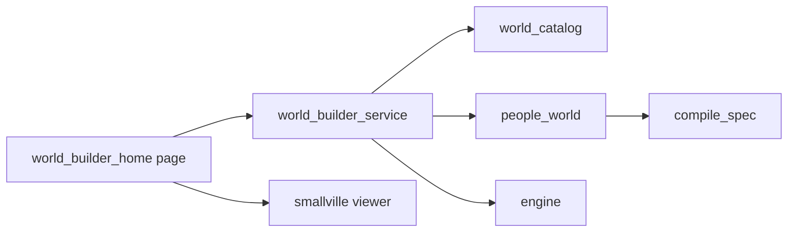

# System map

Question: which code units is the World Builder made of, and what does each do? Units are the globs in `system_model.units` of `docs/planning/planning-package.json`.

## Core engine and rules (src/world_substrate)

| Unit | What it does |
| --- | --- |
| `action_authoring` | Compile constrained authored action mechanics into ordinary ActionRules. |
| `assay` | Interaction assays: search for consequential state an author never declared. |
| `attempt` | Open attempts: a person's own words for what they try, read into one typed move (docs/plans/open_attempt.md, piece 1). |
| `authoring` | Compile a declared mechanic into a registrable process rule. |
| `engine` | Canonical transition authority with causal events and exact replay. |
| `exchange` | Derived, read-only exchange classification over committed give events. |
| `information` | First-class information representation and actor-visible delivery semantics. |
| `laws` | A world's own declared laws, checked at every commit (declared-laws plan, S2). |
| `living_scene` | Deterministic, read-only logical frames for living-world presentation. |
| `living_scene_layout` | Where each actor stands in a Living Scene frame: one rule for every renderer. |
| `mechanisms` | Mechanic packages (damage, liquid, ownership, thermal, time) the engine installs. |
| `model` | Typed canonical state records for the first neutral vertical. |
| `policy` | Policy adapters: choose an action, never author an effect. |
| `profile` | Mechanic packages, installation validation, and frozen profiles. |
| `projection` | Read-only living-world projection over canonical snapshots and events. |
| `rules` | Registered action and process contracts. |
| `semantic` | Semantic-mechanical bindings per openspec/specs/semantic-binding/spec.md. |
| `semantic_relation` | Read-only LC relation view for World Substrate semantic bindings. |

## World Builder service, page and catalog (scripts)

| Unit | What it does |
| --- | --- |
| `world_builder_app` | Browser script of the World Builder page: build, run, library, branch. |
| `world_builder_core` | Browser helpers shared by the World Builder page. |
| `world_builder_home` | The one World Builder page: chat thread, run view, library (https://brianmills.dev/world-builder/). |
| `world_builder_runs` | List recent World Builder builds and runs from the live run log (owner only). |
| `world_builder_service` | Small same-origin API for World Builder mechanics generation and fresh runs. |
| `world_catalog` | Durable private worlds and immutable round-boundary checkpoint ancestry. |
| `world_dialogue` | Conversation helpers in front of natural-language world building. |
| `world_graph` | The whole system of a world as one graph, plus what each round lit up in it. |
| `world_harness` | Write a people world's rules inside an agent harness (Decision 008). |
| `world_scene_bridge` | Read-only adapter from authored worlds/retained rounds to the existing scene. |

| `people_world` | People worlds for the World Builder: the scenario-spec path (docs/model/ODD.md section 10; the plan docs/plans/scenario_spec_adoption.md is retired). |

## Scene viewer

| Unit | What it does |
| --- | --- |
| `smallville` | Off-the-shelf scene viewer: room map, graph, replay; embedded by the World Builder run view. |

## Describe-any-scenario pipeline (spikes)

| Unit | What it does |
| --- | --- |
| `c2_extreme` | C2: the extreme-conditions check (a needed resource set to zero) on the full model and on the same model |
| `checks` | Layer 1 checks (Decision 007) on a compiled world model, by simulation, not by reading code. |
| `compile_spec` | Compile a ScenarioSpecV1 into a World Substrate bundle and causal model (plan scenario-spec-adoption, check S2). |
| `midrun` | Layer 3 (Decision 007): the game master writes a rule mid-run when a resident attempts something no rule covers. |
| `model_scenario` | Layer 1 modeling step (Decision 007): plain-language scenario -> checked world model. |
| `render_run` | C5: render a run's recorded Engine events with the World Builder's existing automatic replay. |
| `rule_writer` | Single-rule writer (Decision 007 layer 3, also used for layer 1 repairs). |
| `run_scenario` | Layer 2 runtime (Decision 007): LLM residents on Concordia, World Substrate Engine as sole authority. |
| `scenario_spec` | ScenarioSpecV1: the describe-any-scenario world definition (plan scenario-spec-adoption, check S1). |
| `spec_pipeline` | The scenario-spec path of the describe-any-scenario pipeline (plan scenario-spec-adoption, check S4). |
| `spend` | Total model spend for this plan: every llm_client call whose trace id starts with 'any-scenario'. |

